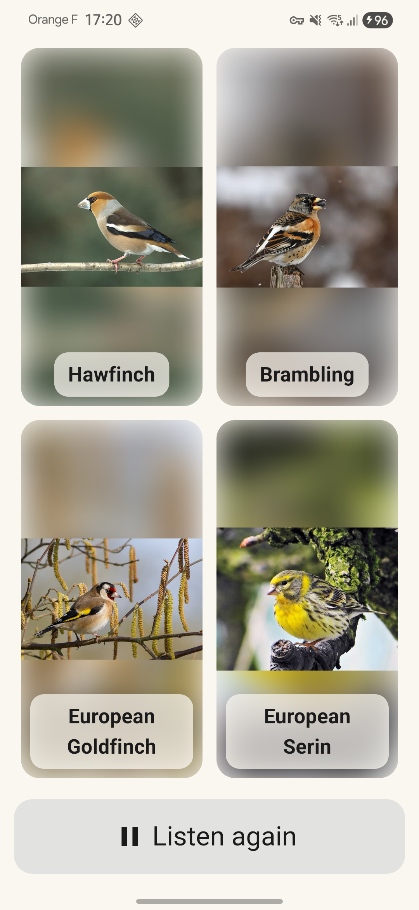
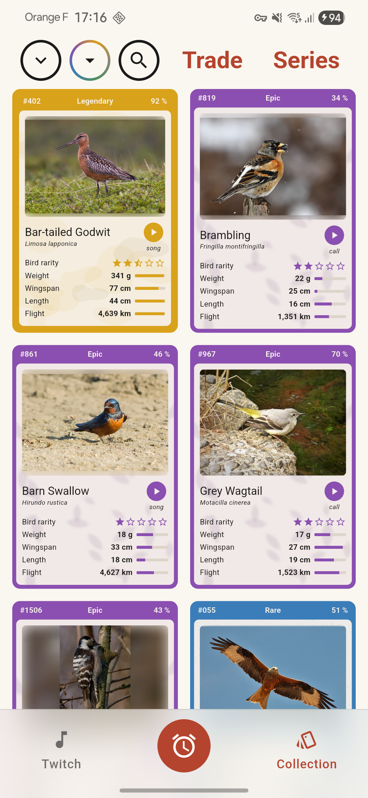
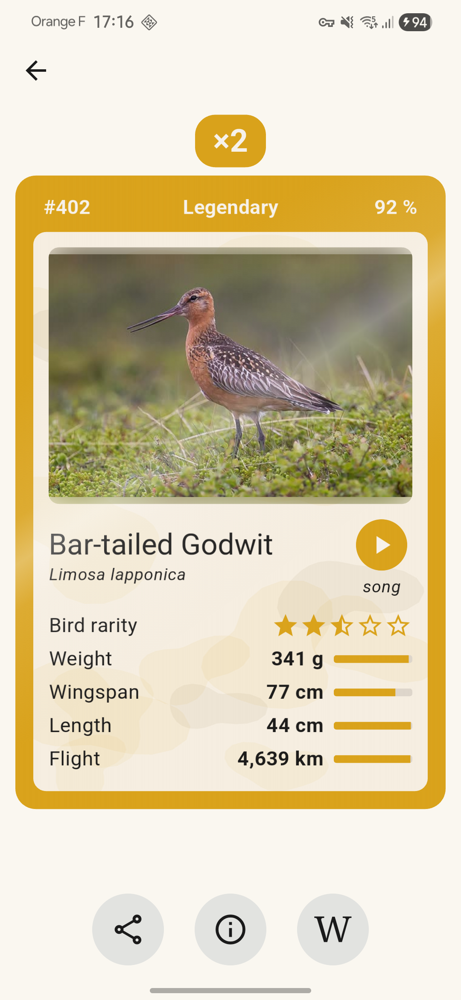
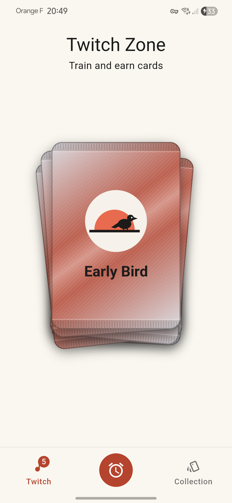
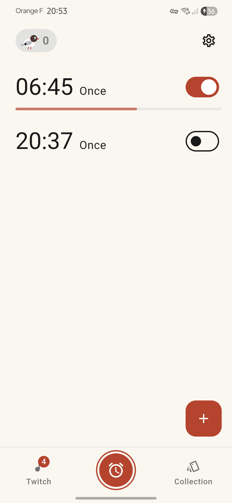

  

<h1 align="center">Early Bird Alarm</h1>

  <b>Wake up to a real bird song. Guess the bird, win its card, learn its song.</b>

  Android · version 1.1.0 · in closed testing on
  <a href="https://play.google.com/store/apps/details?id=com.nathanprovin.earlybird">Google Play</a>

---

Early Bird Alarm is an Android alarm clock that plays a **real recording of a bird that lives
around you, in season**. To stop the alarm, you guess which bird is singing. Guess right and
you win its trading card. Guess wrong and you can listen to all four birds side by side
before moving on. Little by little, you learn the songs of your region.

Free, no ads, no trackers. English, French, German and Spanish.

## Screenshots

  
  
  
  
  

## Features

**The alarm**
- **Local, seasonal birds:** 1,292 species across Europe and North America, from free
  recordings (xeno-canto, iNaturalist). Pick your region on an offline world map, or use your
  position (it never leaves the phone).
- **A gentle wake-up:** the song rises from silence over a minute, then the phone vibrates. The
  quiz shows over the lock screen. A backup alarm rings if anything goes wrong.
- **Four difficulties:** Easy (songs of common birds), Medium (adds calls), Hard (every
  vocalization, rarer birds) and **Expert**, where you type the bird's name instead of choosing
  among four photos.
- **Learn from mistakes:** after a wrong guess, the four photos stay on screen. Tap any of them
  to hear that bird, as long as you like.

**The cards**
- **Six rarities**, from Common to Legendary, plus **Shiny** cards: leucistic or melanistic
  birds, about one in a thousand cards. Each has its own frame material, card stock and reveal.
- **Every card is a specimen:** real statistics of the species (weight, wingspan, length,
  migration distance) rolled for that card, a quality score, one of up to five photos of the
  bird, a **bird group icon**, and the recording it was won with.
- **Training:** a pile of free boosters (one every 15 minutes) to practise between alarms.
- **Achievements and series:** 18 achievements in five tiers, and series by family, habitat,
  voice and theme. Each completed tier or series gives a card of guaranteed rarity.
- Collection views by region or species, search, sort and filters; the species' Wikipedia
  article in your language; share a card as an image.

**With friends (optional account)**
- **Cloud backup** of the collection: an anonymous account by default, Google or email sign-in
  to keep it across phones. Account deletion in the app or on the web.
- **Profile:** a unique @name, an avatar cut from one of your cards, a hall of fame of three
  cards, and your stats.
- **Friends:** add by @name, invite with a link, and **trade cards at a distance**. Both sides
  offer, both agree, and the swap happens on both phones.
- Bonus codes for events and testers.

**Support:** optional tips and **Early Bird Plus** (a booster every minute), through Google
Play. Nothing random is ever sold.

## Repository layout

| Path | What |
|---|---|
| `app/` | The Flutter app (Android) |
| `app/firestore.rules` | Firestore security rules (accounts, profiles, friends, trades); `firestore_rules_check.py` tests them live |
| `pipeline/build.py` | Builds the catalog: regions, species, photos, recordings, stats, series; publishes it |
| `pipeline/series.md` | The series (editable): families, habitats, voices, themes, and their rewards |
| `pipeline/variants.py`, `shiny.py` | Card photo variants and Shiny photos (contact sheets, picks) |
| `pipeline/family_icons.py` | Bird group icons from PhyloPic silhouettes |
| `pipeline/world_map.py` | The offline world map of the region picker (Natural Earth) |
| `pipeline/store_assets.py` | Store icon and feature graphic |
| `site-static/` | Privacy policy and account-deletion pages (4 languages) |
| `store/` | Play Store graphics and screenshots |
| `memory/` | Design decisions, roadmap, store listing |

## How it runs

- **Catalog** on Cloudflare R2 behind `cdn.earlybirdalarm.app`: the phone downloads its region's
  photos and keeps a small pile of upcoming songs, so **alarms always ring offline**.
- **Firebase** (Auth and Firestore, free plan, security rules only) holds per-player data:
  backup, profile, friends, trades, codes. It is never on the alarm's path.
- Building: `flutter build appbundle --release` in `app/`; test builds with developer tools:
  `flutter build apk --profile --dart-define=DEV_TOOLS=true`. The pipeline is Python
  (stdlib) and ffmpeg.

## Data and licences

| Content | Source | Licence |
|---|---|---|
| Presence, seasons, rarity | GBIF.org occurrence data, eBird where dense (monthly counts only) | CC0, CC BY or CC BY-NC, per dataset |
| Names | Wikidata, GBIF | CC0 |
| Photos | Wikimedia Commons, iNaturalist | CC0, public domain, CC BY, CC BY-SA (author and licence on each card) |
| Recordings | xeno-canto, iNaturalist | CC0, CC BY, CC BY-SA (author and licence on each card) |
| Card statistics | AVONET (Tobias et al. 2022, *Ecology Letters*), Wikidata | CC BY 4.0, CC0 |
| Bird group icons | PhyloPic | CC0, Public Domain Mark |
| World map | Natural Earth | Public domain |

The app shows each photo's and recording's author and licence on its card (ⓘ) and in
Settings → Credits.

## Privacy

No ads, no analytics, no trackers. Alarms and settings stay on your phone; the position
(optional) is only used on the phone to pick a region. The collection, profile, friends and
trades are stored in Firebase (EU) for your account, and can be deleted at any time. See the
[privacy policy](https://cdn.earlybirdalarm.app/privacy.html).

## Contact

Questions and feedback: [nanodev009@gmail.com](mailto:nanodev009@gmail.com), or open an
[issue](https://github.com/NathanProvin/EarlyBirdAlarm/issues).

## License

<!-- TODO: choose a licence for the code (e.g. MIT, Apache-2.0, GPL-3.0) and add a LICENSE file -->
The code's licence is not chosen yet. Bird data, photos, recordings and icons keep their own
licences (see above).
